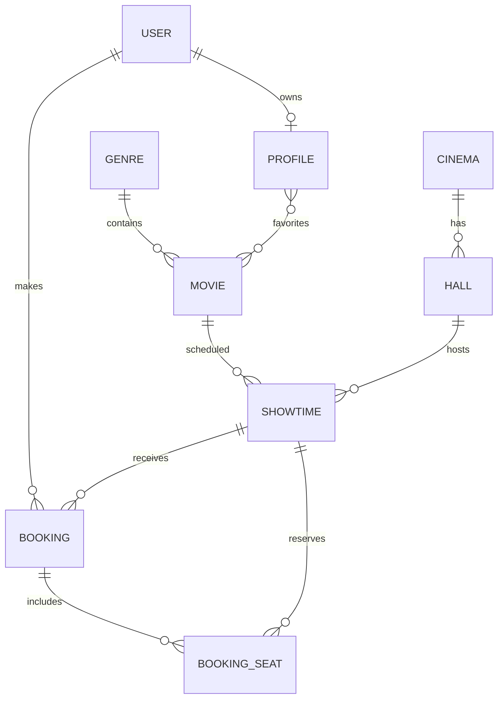

# KINORA — учебный кинотеатр на Django

Основан на предыдущем проекте CinemaSpace. Светлый интерфейс, реальные названия фильмов и актёров, демонстрационный механизм бронирования и QR-билетов.

**Важно:** сеансы в Дордой Плаза, Томми Молл и Азия Молл здесь СГЕНЕРИРОВАНЫ ДЛЯ УЧЁБЫ и не отражают реальное расписание. Цены условны. Платежи не принимаются. QR не является действительным билетом в кинотеатр. Постеры загружаются с TMDB CDN; требуется Интернет, ссылки могут перестать работать. Некоторые предстоящие фильмы без официальных постеров показаны карточками-заглушками.

## Запуск Windows / PyCharm

Открой папку KINORA_Cinematic в PyCharm (внутри находится файл manage.py). Терминал открывай в этой же папке.

```powershell
py -3.12 -m venv .venv
.\.venv\Scripts\python.exe -m pip install -r requirements.txt
.\.venv\Scripts\python.exe manage.py makemigrations movies booking
.\.venv\Scripts\python.exe manage.py migrate
.\.venv\Scripts\python.exe manage.py seed_demo
.\.venv\Scripts\python.exe manage.py createsuperuser
.\.venv\Scripts\python.exe manage.py runserver
```

Если Python 3.12 отсутствует — установи его или (для локальной практики) замени `py -3.12` на `py -3.10`. Открой http://127.0.0.1:8000/ . Админка http://127.0.0.1:8000/admin/ .

### Что проверить

1. Главная / каталог / поиск `?q=...` / жанры / подробная страница фильма.
2. Регистрация `/tickets/signup/`, вход `/accounts/login/`, выход, профиль `/tickets/profile/`.
3. Фильм → сеанс → занятость мест → заказ → **демо-оплата** → QR → проверка QR.
4. Админка: жанры, фильмы, кинотеатры, залы, сеансы, брони и пользователи.
5. «Холодное сердце 3» — в разделе «Скоро в кино» без бронирования до выхода.

### Для защиты

- Django MTV: `models.py` — данные SQLite; `views.py` — запросы; `templates/` — представление HTML.
- `Genre → Movie` и `Cinema → Hall → Showtime`: One-to-Many.
- `Profile → favorites`: Many-to-Many; `User ↔ Profile`: One-to-One.
- SQLite ORM: `select_related`, `filter`, `Q`, `get_object_or_404`.
- CSRF защищает POST формы. `login_required` ограничивает оформление.
- Уникальность `(showtime, row, number)` + транзакции защищают от двух продаж одного места в базе (SQLite имеет ограничения при очень высокой конкуренции).
- Реальных платежей НЕТ: для них нужен договор с провайдером, серверная проверка вебхуков, идемпотентность и безопасная обработка платёжного статуса.
- QR ссылка содержит непредсказуемый UUID и показывает статус демо-билета. Для промышленного использования нужны контроль допуска, одноразовое погашение и дополнительная проверка подписи.
- Для production: выставить `DJANGO_SECRET_KEY`, `DJANGO_DEBUG=0`, `DJANGO_ALLOWED_HOSTS` и настроить HTTPS, постоянное хранилище статики, рабочую БД и сервис платежей.

**Права на фильмы, постеры и марки принадлежат правообладателям.** Проект не аффилирован с кинотеатрами или студиями.
## ER-диаграмма базы данных KINORA

Диаграмма показывает связи между основными моделями приложения.

